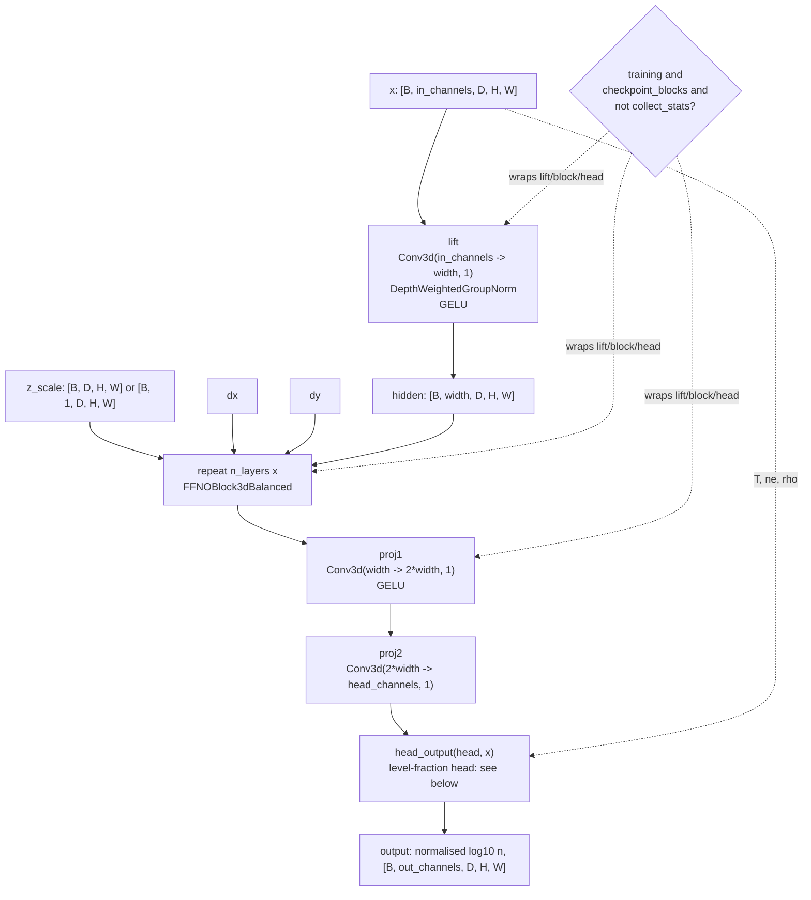
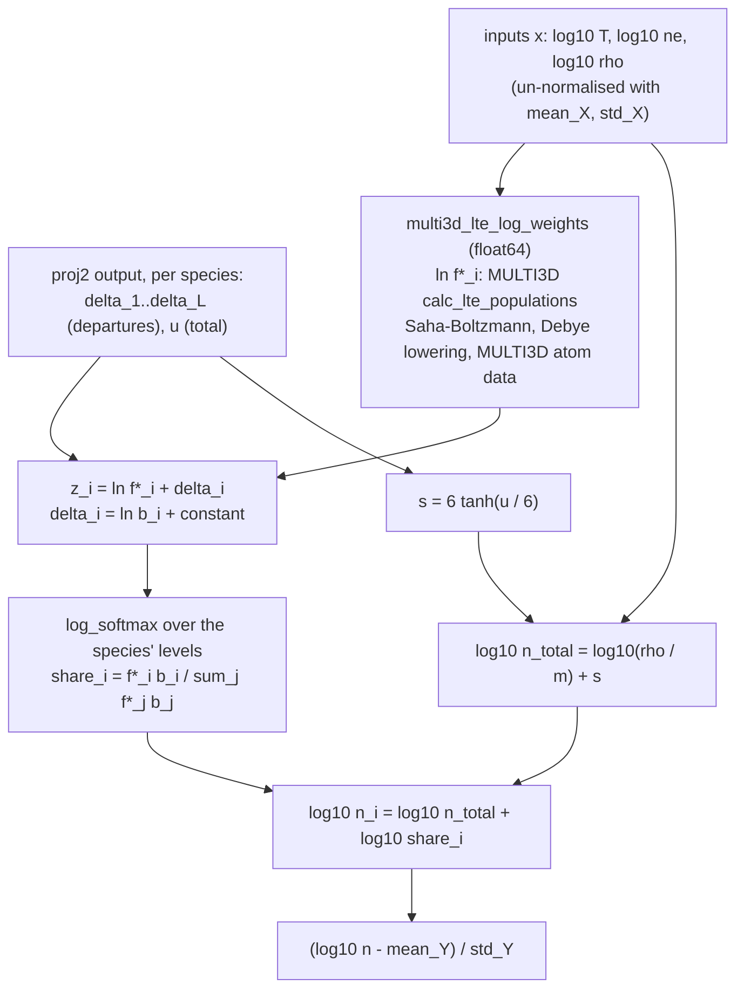
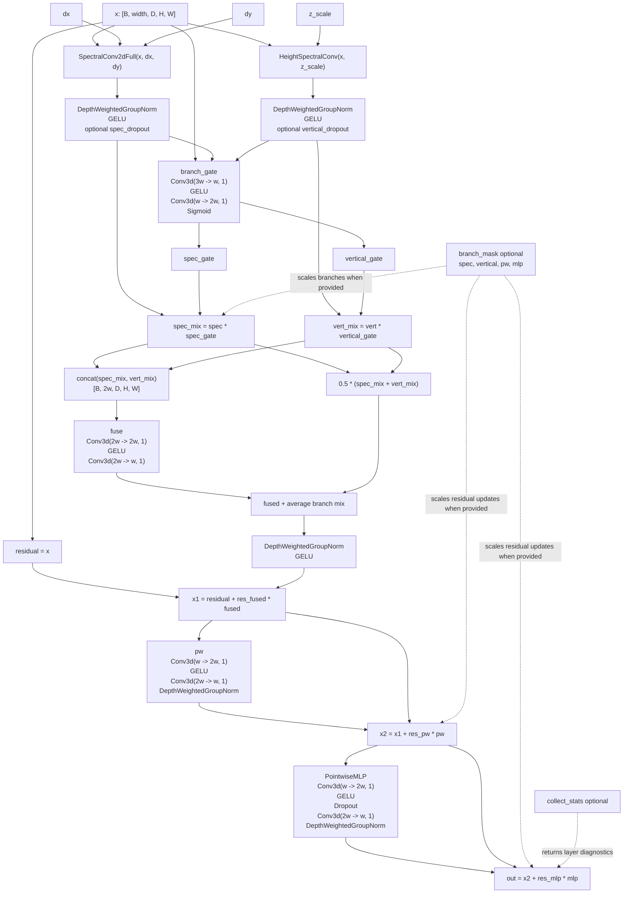
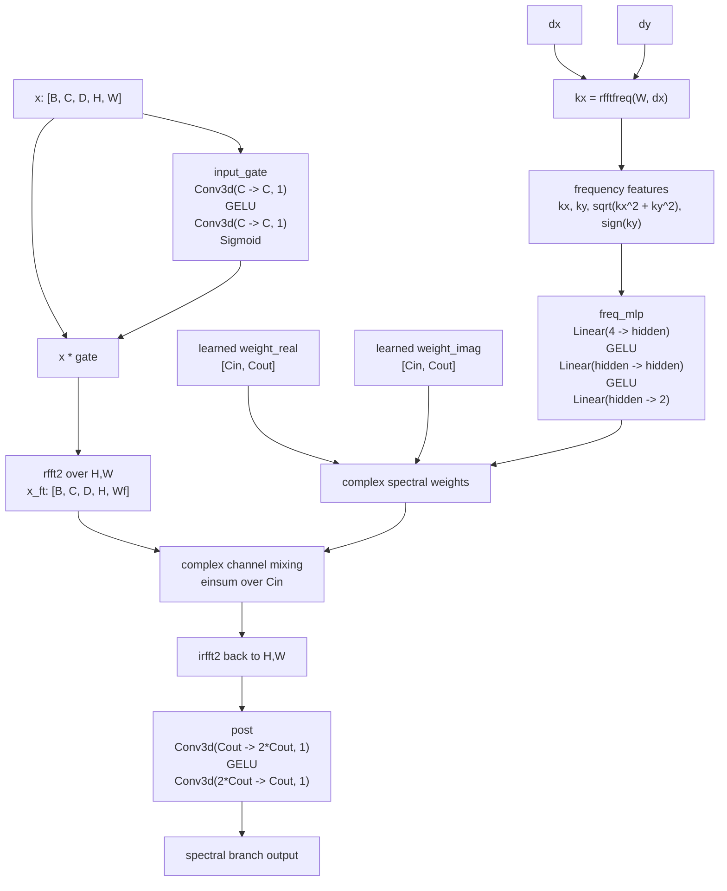
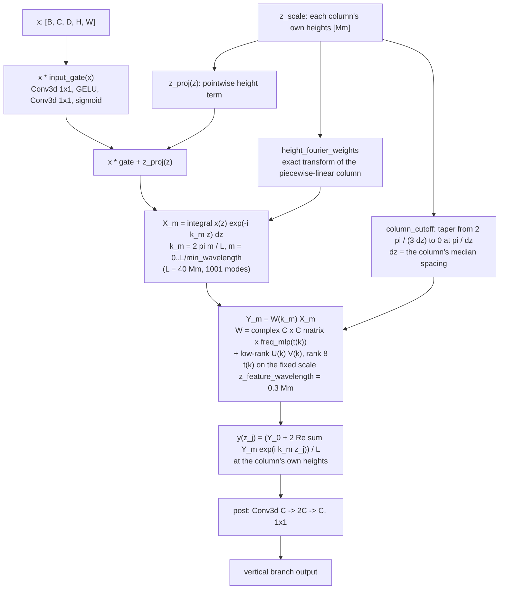

# FFNO3D Model Flowchart

Source: [`models/ffno_model.py`](../models/ffno_model.py)

## Full Forward Pass

`head_channels` is `out_channels + n_species`: one departure value per level and one total correction per species.

This is the final model (zaug, `config.py`'s defaults, width 96), the only one this branch builds. Every GroupNorm is a
`DepthWeightedGroupNorm` (statistics weighted by each level's share of the column height), each block's vertical
branch is `HeightSpectralConv` (a spectral convolution along height, low-rank mixing of rank 8, column cutoff), and
the fusion is pointwise.

## Level-fraction head with departure coefficients

δ = 0 gives MULTI3D's LTE populations; the network learns the departure coefficients (up to a constant per species)
and the total's small offset from ρ / m. The head has no parameters of its own.

## `FFNOBlock3dBalanced`

## `SpectralConv2dFull`

With `freq_mix_rank` 8 a second MLP of the same frequency features gives each wavenumber its own low-rank channel
mixing U(k) V(k), added to the complex channel mixing (U starts at zero).

## `HeightSpectralConv`

## Residual Scalars

The block learns three scalar residual strengths:

| Parameter | Initial value | Applied to |
| --- | ---: | --- |
| `res_fused` | `1.0` | gated spectral/vertical fusion |
| `res_pw` | `0.5` | pointwise convolution correction |
| `res_mlp` | `0.5` | pointwise MLP correction |

